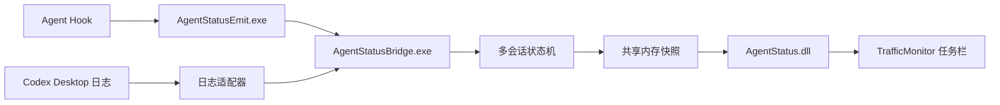

# TrafficMonitor Agent Status

TrafficMonitor Agent Status 是一个 Windows TrafficMonitor 插件，用于在任务栏中显示本机 Agent 工具的当前状态。它把多个 Agent 会话的事件归一化后，显示最需要关注的一项，例如：

- `Codex:工作中`
- `Cursor:调用工具`
- `Claudecode:待回答`
- `Claudecode:待授权`
- `Codex:本轮完成`

等待授权、等待回答、调用工具和工作中的显示优先级依次降低；同一优先级优先显示最近更新的会话。点击任务栏项目可查看会话详情和调整来源、文案及超时设置。

<!-- 运行效果截图由项目维护者补充到这里。 -->

## 已支持的来源

| 来源 | 接入方式 | 当前验证情况 |
|---|---|---|
| Codex Desktop | Bridge 增量读取本地会话日志 | 工作、工具调用和本轮完成已实机验证 |
| Claude Code | 用户级命令 Hook | 基本生命周期已实机验证 |
| Cursor Agent | 用户级命令 Hook | 工作、工具调用和本轮完成已实机验证 |
| Codex CLI / TUI | 用户级命令 Hook | 已完成协议映射，仍需更多实机验证 |
| Gemini CLI | 用户级命令 Hook | 已完成协议映射，仍需实机验证 |

插件只观察状态，不批准、拒绝或修改 Agent 的操作。Cursor 当前没有可被动监听的完整授权解除事件，因此普通工具调用不会显示成“待授权”。

## 工作方式



详细模块划分见 [`docs/项目架构与安装方案.md`](docs/项目架构与安装方案.md)。

## 交给 Agent 安装

下载并解压发布包，然后把**整个发布目录**和下面这段任务交给能够读取文件、修改配置并执行命令的 Agent。不要只提供 `AgentStatus.dll`，Bridge、事件入口及其 .NET 运行依赖也必须同时交付。

> 阅读此发布包的 README 和项目架构说明。检查本机正在运行的 TrafficMonitor 安装位置、版本和架构，以及实际使用的 Agent 工具。修改前备份相关文件并保留已有 Hook。把 AgentStatus.dll 安装到 TrafficMonitor 的 plugins 目录，把完整 AgentStatus 子目录安装到 plugins\AgentStatus。确保 AgentStatusBridge.exe 由当前普通桌面用户运行并随用户会话启动。只为本机实际使用的 Agent 配置对应 Hook。完成后检查 Bridge 连通性，并实测“工作中 → 调用工具 → 本轮完成”；能够触发询问或授权的工具还要验证等待状态及解除。遇到格式或版本不兼容时，根据实际配置、诊断日志和源码调整；失败则恢复修改前的文件。

发布包应包含：

```text
AgentStatus.dll
Install-PluginFiles.ps1
AgentStatus/
├─ AgentStatusBridge.exe
├─ AgentStatusEmit.exe
├─ AgentStatusJsonHook.cmd
├─ Install-AgentHooks.ps1
├─ Configure-ClaudeHook.ps1
├─ AgentStatusBridge.deps.json
├─ AgentStatusBridge.runtimeconfig.json
└─ Bridge 自包含运行文件
```

安装完成后的目标结构是：

```text
<TrafficMonitor>/
└─ plugins/
   ├─ AgentStatus.dll
   └─ AgentStatus/
      ├─ AgentStatusBridge.exe
      ├─ AgentStatusEmit.exe
      └─ ...
```

关键约束：

- 当前交付目标是 Windows x64，TrafficMonitor、插件和 Bridge 架构必须一致。
- 覆盖正在使用的 DLL 前先退出 TrafficMonitor，覆盖 Bridge 文件前先停止旧 Bridge。
- Bridge 必须由普通桌面用户启动。管理员权限 Bridge 可能使普通权限 Agent 无法连接命名管道。
- Agent 配置必须先解析并备份，再合并本插件 Hook；不能覆盖其他 Hook 或权限规则。
- Codex Desktop 依赖 Bridge 主动监听会话日志，因此需要确保 Bridge 随用户会话启动。
- Hook 调用失败不得阻塞 Agent 的正常工作。

TrafficMonitor 重启后，在任务栏显示项目中启用“Agent 状态”。Agent 工具通常需要重新启动或新建会话才能载入新增 Hook。

## 验证与排错

在普通用户权限的终端中运行已安装的 Bridge：

```powershell
& '<TrafficMonitor>\plugins\AgentStatus\AgentStatusBridge.exe' ping
& '<TrafficMonitor>\plugins\AgentStatus\AgentStatusBridge.exe' snapshot
```

`ping` 应返回 `ok: true`、版本和 Bridge 进程 ID；`snapshot` 可查看收到的会话、状态和事件计数。然后让对应 Agent 完成一轮包含工具调用的任务，观察任务栏是否依次显示工作、工具和完成状态。

诊断文件位于：

```text
%LOCALAPPDATA%\TrafficMonitorAgentStatus\diagnostics.log
```

诊断日志只记录来源、事件名、进程、Windows 用户/会话标识、传输阶段、错误码和耗时，不记录提示内容、工具参数或工具输出。排错时应分别确认：

1. Agent 是否产生了目标 Hook 或 Codex Desktop 日志事件。
2. `AgentStatusEmit.exe` 是否被调用。
3. 事件是否成功到达 Bridge。
4. `snapshot` 中是否形成了预期状态。
5. TrafficMonitor 是否加载 DLL 并读取共享内存。

Hook 配置说明见 [`docs/适配器安装.md`](docs/适配器安装.md)。

## 更新和回滚

更新前备份当前 `AgentStatus.dll` 和 `plugins\AgentStatus` 中将被覆盖的同名文件。Hook 命令仍指向相同安装目录时，普通程序更新不需要重复配置 Hook。

新版本异常时，停止 TrafficMonitor 和 Bridge，把同一次备份的文件逐个恢复，再从普通用户会话启动 Bridge。卸载时移除本插件文件、Bridge 启动项，并精确删除指向本插件路径和来源参数的 Hook；保留其他工具配置。

## 从源码构建

需要 .NET 10 SDK、MSVC x64 C++ 工具和 Windows SDK。构建脚本不包含开发者本机路径，调用时明确传入同时包含 `VC\Tools\MSVC` 和 `Windows Kits\10` 的工具链根目录：

```powershell
.\build.ps1 -Toolchain '<toolchain-root>' -SelfContained
```

输出位于 `build\x64`，可交付目录位于 `dist\TrafficMonitorAgentStatus-win-x64`。两者均由构建产生，不作为源码提交。具体流程见 [`docs/构建与验证.md`](docs/构建与验证.md)。

## 隐私与边界

所有事件、状态和配置都保留在当前 Windows 用户的本机环境中。Bridge 使用当前用户专用的命名管道，并通过当前登录会话的共享内存向 TrafficMonitor 发布简短快照。

该状态显示不是安全边界：同一 Windows 用户下的其他进程理论上可以发送伪造状态。插件不能代替 Agent 自身的授权界面。

## 当前限制

- Codex Desktop 依赖未承诺稳定格式的本机会话日志，需要随客户端版本持续验证。
- 任务栏宽度当前由 TrafficMonitor 依据固定示例文本预留；动态宽度列入后续计划。
- 等待状态和 Codex Desktop 长期监听仍有稳定性改进计划，详见 [`docs/开发进度.md`](docs/开发进度.md)。
- 当前仅提供 x64 构建，尚未覆盖 WSL、远程主机和多用户服务场景。

## 开发状态

项目目前是首个公开版本前的开发状态。已有状态机、来源映射、原生插件 ABI 和集成回放测试；各来源的真实授权/回答流程、干净环境安装和长期运行仍需补充验证。
