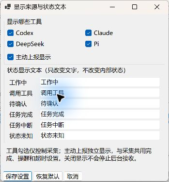
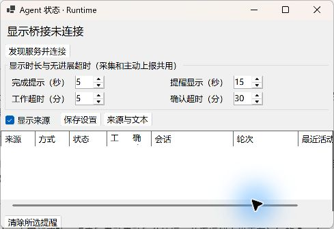

# TrafficMonitor Agent Status

写代码时不用一直切回 Agent 窗口看进度了。这个插件会把 Agent 的状态放到 Windows 任务栏里：在工作、调用工具、等你确认，还是已经完成，一眼就能看到。

它是 [TrafficMonitor](https://github.com/zhongyang219/TrafficMonitor) 的插件，状态由本机的 Agent Status Runtime 提供。目前支持 Windows x64。

## 看看效果


以上是实际 TrafficMonitor 显示区域的截图拼图，使用隔离演示会话依次展示六种状态。各工具能提供哪些状态，取决于 Runtime 的采集和上报能力。

## 怎么安装

1. 先到 [Agent Status Runtime 下载页](https://github.com/aoang-git/Agent_Status_Runtime/releases)，下载并运行 `agent-status-setup.exe`。装好后它会在后台运行，后续登录也会自动启动。
2. 准备本插件 **0.2.4 或更新版本**的 Windows x64 压缩包，解压到一个普通文件夹。发布包位于[本插件发布页](https://github.com/aoang-git/TrafficMonitorAgentStatus/releases)。
3. 退出 TrafficMonitor（升级时同时停止后台 AgentStatusBridge），将发布包中的 **AgentStatus.dll** 和完整的 **AgentStatus 文件夹**复制到 TrafficMonitor 的 `plugins` 目录。
4. 启动 TrafficMonitor，在任务栏显示项目中勾选 **Agent 状态**，打开插件设置，点击 **发现服务并连接**。首次成功连接时会同时登记 Bridge 的当前用户登录自启动项，后续重启无需再次点击。

Runtime 已经装过并在运行的话，第一步可以跳过。插件安装包自带运行依赖，不用再单独安装 .NET。目录移动后重新点击一次“发现服务并连接”，即可更新自启动路径。如果提示自动连接设置失败，需要检查启动项权限；Windows 启动应用中也需保持该启动项启用。

也可以用 PowerShell 7 执行发布包中的安装脚本，自动完成文件部署和自启动注册；升级旧版本时它还会先备份旧文件和配置：

```powershell
.\Install-PluginFiles.ps1 -TrafficMonitorDirectory 'D:\Tools\TrafficMonitor'
```

## 平时怎么用

不用每次手动启动。登录后显示桥接程序会在后台运行，有新活动时任务栏就会更新。点击任务栏里的 Agent 状态，可以打开详情和设置。需要手动连接时，点击“发现服务并连接”：它会自动查找当前用户的 Runtime，必要时启动已安装的服务。未安装时显示“未发现Runtime服务”，按钮不负责安装。先装插件或先装 Runtime 均可。

- **工作中、调用工具、待确认**：看看 Agent 现在进行到哪一步。
- **任务完成、任务中断**：显示一会儿后自动消失。
- **状态未知**：暂时缺少足够的新进展，或者来源出了问题；它不代表任务成功。

没有活动时，任务栏的 Agent 文本会留空。刚启动或重新连接后，会等待新的活动，不把过去的任务重新显示出来。

### 本地监测和主动上报

Runtime 可以观察 Codex、Claude、DeepSeek DSH 和 Pi 的本地活动；其他工具也可以通过 Runtime 主动上报自己的状态。具体覆盖范围见[运行逻辑与排错](docs/运行逻辑与排错.md)。

本地监测会优先显示需要你关注的会话：待确认优先，其次是工具调用、工作中；同类状态选择最近更新的会话。

主动上报开启时，上报结果会优先显示。本地监测仍在后台更新，但不会打断它；新的主动上报会替换旧结果。两类来源共用四个时间设置：完成默认提示 **5 秒**，中断和未知默认提示 **15 秒**；工作和工具状态无进展 **5 分钟**、待确认无进展 **30 分钟**后转为未知，再按提醒时长清除。相同轮次连续重复的结束结果不会反复提示。

## 可以调哪些设置





四个时间选项在详情窗口按两行两列排列，采集和主动上报共用。

- 勾选需要看的工具，隐藏其他工具的本地监测状态。
- 单独开关 **主动上报显示**，它与工具勾选互不影响。
- 把“工作中”“任务完成”等文字改成自己喜欢的叫法。
- 在详情窗口调整是否显示来源、完成提示、提醒显示、工作超时和确认超时。Runtime 服务自动发现，无需选择目录。

当前“待确认”的内置采集来自 DeepSeek 的审批记录，审批有时会自动通过；其他工具主动上报确认状态时也能显示。它只是状态提醒，不能代替 Agent 自己的确认或授权窗口。

## 进一步了解

- [运行逻辑与排错](docs/运行逻辑与排错.md)：状态含义、显示时长、日志和诊断命令。
- [架构与安装细节](docs/项目架构与安装方案.md)：组件关系、配置和接口边界。
- [构建与验证](docs/构建与验证.md)：从源码构建、回归测试和截图说明。
- [自动构建与发布](docs/自动构建与发布.md)：推送 main 更新开发版，推送版本标签自动发布正式安装包。

项目采用 [MIT License](LICENSE)，第三方组件见 [THIRD_PARTY_NOTICES](THIRD_PARTY_NOTICES.md)。
