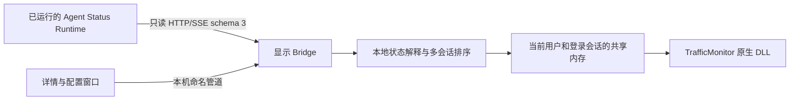

# 架构与安装

DLL 无后台线程，不执行网络操作。DataRequired 只作有界共享内存读取，通过序列锁避免撕裂，3 秒未更新的快照视为不可用。Bridge 每 200 毫秒发布快照，单用户登录会话内互斥启动。

Runtime 目录默认 `%APPDATA%\AgentStatusRuntime`。Bridge 读取 private/connection.json，以只读 Bearer 凭据访问 /v3/info 和 /v3/events，验证 schema=3、mode=facts、epoch 及 SSE 游标。HTTP 禁止代理和自动跳转，发现地址只允许字面量回环 IP；凭据不进入日志、界面或 URL。

SSE 首帧 ready 确立订阅边界。不查询 recent，不发送 Last-Event-ID，不恢复任务。断连、gap、实例或凭据变化时重新发现服务。45 秒无数据或心跳断开；失败后按 1、2、5、10 秒间隔重试。修改 Runtime 目录会终止旧订阅并重新连接。

文件采集会话按 agent、session_namespace、session_id 隔离，operation_id 标识当前轮次。工具和确认请求按各自 ID 跟踪，旧轮次事件不能结束新轮次。来源健康、未知和心跳不续期，证据缺口阻止普通消息静默结束判断。最多保留 128 个会话，每会话工具、确认各最多 1024 项，已替换轮次最多 128 个，来源最多 256 种。

主动上报（origin=external、kind=state.reported）按 source_id、agent、session_namespace、session_id 独立保存，最多保留 128 项，不进入采集状态机。新上报按 Runtime 接收顺序直接替换同一来源会话的结果，完成之后也允许新状态。有效上报优先于采集；多条上报选择最新接收 ID。

ShowReportedStates 默认 true；ReportedStateLeaseMs 默认 60000，归一化至 1000～3600000。租约以本机单调接收时间计算，所有上报状态均适用，到期删除；不使用 Runtime occurred_at、工作超时或完成提示时长。变更配置时先按旧截止时间删除过期项，再为剩余项重算截止时间，避免延长配置使已过期结果恢复。关闭显示不停止接收或计时；断线、gap 和重新订阅清空上报及采集状态。重复 SSE 接收 ID 不续租。

快照 SessionView 增加 Origin（file/external），详情将其格式化为“采集／主动上报”。主动上报清除操作只移除本地结果。工具勾选仅作用于采集，上报使用独立开关；KnownSources 仅记录文件采集工具。

明确结束与正常消息静默结束都只输出结果状态，无进展超时输出未知。本地清除提醒不写回 Runtime，也不批准或拒绝 Agent 操作。Runtime schema 3 没有足够信息时统一为“待确认”，不解析业务正文或猜测工具参数。

安装文件只有 plugins/AgentStatus.dll 和 plugins/AgentStatus 下的自包含 Bridge 依赖。安装器在替换前校验清单、备份现有安装及相关配置，移除精确指向本安装目录的旧 Hook，不修改 Codex 其他插件配置。显示 Bridge 使用当前用户 Run 启动项，不安装第二份 Runtime。
