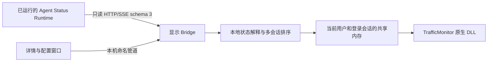

# 架构与安装

DLL 无后台线程，不执行网络操作。TMPluginGetInstance 与 DataRequired 在正常回调中读取有界共享内存，通过序列锁避免撕裂，3 秒未更新的快照视为不可用。快照不可用时自动拉起同目录 Bridge，不等待后台就绪，启动尝试间隔至少 5 秒。Bridge 每 200 毫秒发布快照，单用户登录会话内互斥启动。

CreateProcess 只继承宿主进程与插件停止事件的两个 SYNCHRONIZE 只读句柄。Bridge 监听两个内核句柄，宿主进程退出（包括强制终止）或 DLL 卸载即取消服务并退出，不依赖 PID 轮询或独立登录启动项。DllMain 仅记录模块及发出卸载信号，不创建进程、等待子进程或发起网络请求。

Runtime 目录默认 `%APPDATA%\AgentStatusRuntime`。Bridge 读取 private/connection.json，以只读 Bearer 凭据访问 /v3/info 和 /v3/events，验证 schema=3、mode=facts、epoch 及 SSE 游标。HTTP 禁止代理和自动跳转，发现地址只允许字面量回环 IP；凭据不进入日志、界面或 URL。

SSE 首帧 ready 确立订阅边界。不查询 recent，不发送 Last-Event-ID，不恢复任务。断连、gap、实例或凭据变化时重新发现服务。45 秒无数据或心跳断开；失败后按 1、2、5、10 秒间隔重试。连接入口为“发现服务并连接”，不开放目录选择；启动 Bridge 时自动发现当前用户服务，必要时调用标准安装目录的 agent-statusd.exe start，复用 Runtime 自身计划任务，不安装 Runtime。已连接时点击按钮保留当前订阅；正在启动连接时合并重复请求。

文件采集会话按 agent、session_namespace、session_id 隔离，operation_id 标识当前轮次。工具和确认请求按各自 ID 跟踪，旧轮次事件不能结束新轮次。来源健康、未知和心跳不续期，证据缺口阻止普通消息静默结束判断。最多保留 128 个会话，每会话工具、确认各最多 1024 项，已替换轮次最多 128 个，来源最多 256 种。

主动上报（origin=external、kind=state.reported）按 source_id、agent、session_namespace、session_id 独立保存，最多保留 128 项，不进入采集状态机。新上报按 Runtime 接收顺序直接替换同一来源会话的结果，完成之后也允许新状态。有效上报优先于采集；多条上报选择最新接收 ID。

ShowReportedStates 默认 true。主动上报与采集共用 CompletionToastMs、NoticeToastMs、MaxWorkingMs、MaxWaitingMs：完成默认 5 秒，中断/失败/未知默认 15 秒，工作/工具无进展 5 分钟及等待无进展 30 分钟后转未知，再按提醒时长清除。所有计时采用本机单调时钟，不使用 occurred_at。同轮次连续重复的结束结果不延长或重现提示，过期后在最多 128 项的会话容器中仅保留去重所需状态，不进入显示列表。修改配置先处理旧截止时间，不恢复过期提示或撤回超时。关闭显示继续计时和接收；断线、gap、重新订阅清空全部状态。旧租约和手选目录字段读取时忽略，保存和安装升级时删除。

快照 SessionView 增加 Origin（file/external），详情将其格式化为“采集／主动上报”。主动上报清除操作只移除本地结果。工具勾选仅作用于采集，上报使用独立开关；KnownSources 仅记录文件采集工具。

明确结束与正常消息静默结束都只输出结果状态，无进展超时输出未知。本地清除提醒不写回 Runtime，也不批准或拒绝 Agent 操作。Runtime schema 3 没有足够信息时统一为“待确认”，不解析业务正文或猜测工具参数。

安装文件只有 plugins/AgentStatus.dll 和 plugins/AgentStatus 下的自包含 Bridge 依赖。安装器在替换前校验清单、备份现有安装及相关配置，移除精确指向本安装目录的旧 Hook，不修改 Codex 其他插件配置。显示 Bridge 跟随 TrafficMonitor 宿主生命周期，不创建独立登录启动项；仅清理指向本项目旧桥接 serve 命令的遗留 Run 项，其他条目保留。命名管道仅授权当前用户并拒绝网络访问，兼容同一用户普通与管理员进程；启动探测遇到访问拒绝会报告权限问题，不再盲目启动第二份 Bridge。
