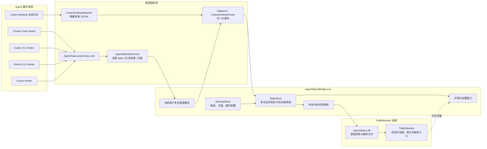

# 项目架构与安装方案

## 1. 总体架构



正常的 Hook 数据路径是：

`Agent Hook → AgentStatusJsonHook.cmd → AgentStatusEmit.exe → 当前用户命名管道 → 来源适配 → 状态机 → 共享内存 → AgentStatus.dll → TrafficMonitor`。

Codex Desktop 当前没有走同一条 Hook 路径，而是由 Bridge 增量读取本机会话日志，再送入相同的状态机。因此，所有来源从事件归一化之后共用状态选择、显示和配置逻辑。

## 2. 功能模块

| 模块 | 当前职责 | 主要文件 |
|---|---|---|
| TrafficMonitor 插件 | 注册显示项目，读取共享内存，缓存显示文字，提供悬停说明和点击入口 | `plugin/AgentStatus.cpp`、`plugin/PluginInterface.h` |
| 原生事件入口 | 从 Agent Hook 的标准输入读取 JSON，去除 UTF-8 BOM，发送到命名管道；接收器缺失时尝试启动 Bridge；记录有限的传输诊断 | `plugin/AgentStatusEmit.cpp` |
| Hook 命令包装 | 调用原生事件入口，并满足部分 Agent 对标准输出格式的要求 | `adapters/AgentStatusJsonHook.cmd` |
| 来源适配器 | 将 Claude、Codex CLI、Gemini、Cursor 的不同 Hook 字段映射为统一 `StatusEvent` | `bridge/Adapters.cs` |
| Codex Desktop 适配 | 发现和增量读取 Codex Desktop JSONL，会话识别，映射任务、工具、提问和完成事件 | `bridge/CodexDesktop.cs` |
| 本地传输 | 当前 Windows 用户和登录会话专用的命名管道、共享内存、消息大小限制和请求处理 | `bridge/Transport.cs` |
| 多会话状态机 | 管理工作、工具、回答、授权、完成、异常状态；去重、超时；从多个会话中选择任务栏状态 | `bridge/State.cs` |
| 显示调度 | 当前优先级为待授权、待回答、调用工具、工作中；同优先级优先显示最近更新的会话 | `bridge/State.cs` |
| 运行配置 | 启用来源、自定义状态文案、完成提示时长、工作超时、Codex 扫描间隔 | `bridge/Settings.cs` |
| 详情界面 | 展示活动会话、计数和状态，编辑显示设置 | `bridge/DetailsForm.cs`、`bridge/DisplaySettingsForm.cs` |
| Hook 配置安装 | 合并 Codex CLI、Gemini 和 Cursor 用户级 Hook，备份已有配置 | `adapters/Install-AgentHooks.ps1` |
| 文件安装与打包 | 编译原生和 .NET 模块，组装可交付目录；提供可选的文件复制工具 | `build.ps1`、`tools/Install-PluginFiles.ps1` |
| 自动验证 | 状态机、来源映射、共享内存、原生 ABI、并发读取和真实 Claude 冒烟测试 | `tests/` |

## 3. 安装方式选择

### 面向 Agent 的安装资料

本插件的目标用户已经在使用 Codex、Claude Code、Cursor 或 Gemini 等 Agent 工具。安装流程不需要再次实现一个固定步骤的传统安装器；用户可以把项目地址或发布包交给 Agent，让 Agent 根据当前电脑的实际环境理解目标、检查路径、执行安装并处理异常。

首版推荐提供以下材料：

- 完整且结构稳定的发布包。
- 一份面向 Agent 和人工阅读的 `INSTALL.md`。
- 每种工具需要合并的 Hook 配置模板。
- 插件文件、Bridge、Emitter 及其版本和校验值。
- 安装成功的可观察条件和诊断位置。
- 升级、回滚和卸载时需要移除的明确文件与配置项。

`INSTALL.md` 应描述目标和约束，而不是假定固定安装路径。示例指令可以是：“检查本机 TrafficMonitor 和所用 Agent 的实际配置，把发布包安装到正确位置，保留已有 Hook，确保 Bridge 以当前普通用户运行，然后验证一次工作、工具调用和完成状态。”Agent 可以据此选择适合当前机器的命令。

### 保留少量辅助文件

现有的文件复制和 Hook 合并脚本可以继续作为可复用工具，但它们不是唯一安装入口，也不需要扩展成覆盖所有环境的安装框架。Agent 可以读取、调用、修改或绕过这些脚本。

辅助文件只需承担确定性较高的局部操作：

- 将已确认的发布文件复制到用户指定目录。
- 给已确认格式的配置文件合并 Hook。
- 输出 Bridge 的连通性或版本信息。

环境发现、兼容判断、权限调整和错误恢复由执行安装的 Agent 根据现场情况完成。项目只需给出充分条件和禁止破坏的边界，例如保留现有 Hook、修改前备份、Bridge 不以管理员权限运行。

### 不集成到 AgentStatus.dll

插件 DLL 运行在 TrafficMonitor 进程内，不适合修改其他程序的用户配置、注册启动项或申请权限。DLL 继续只负责读取状态、显示状态和打开详情窗口。这样即使安装或适配失败，也不会扩大到 TrafficMonitor 运行时。

## 4. Agent 安装说明需要回答的问题

安装文档应让任意具备文件和命令能力的 Agent 能独立完成以下判断：

1. 发布包中的每个文件有什么用途，哪些必须放在同一目录。
2. 如何找到当前电脑真正运行的 TrafficMonitor 及其插件目录。
3. 如何确认 TrafficMonitor 架构、版本和插件接口兼容。
4. 如何停止或重启被占用的 Bridge 和 TrafficMonitor，而不影响 Agent 配置。
5. 如何保留已有 Hook，并为用户实际使用的 Agent 添加对应事件。
6. 如何确保 Bridge 由当前普通桌面用户启动，避免管道权限不匹配。
7. 如何验证 DLL 已加载、Bridge 已运行、Hook 已触发、事件已接收以及任务栏已显示。
8. 每一步失败时应查看哪个日志、配置或进程状态。
9. 如何恢复备份、降级到旧版本或完整卸载。
10. 哪些 Agent 和版本经过实机验证，哪些只是协议适配、需要现场确认。

仓库可以提供一段可直接交给 Agent 的安装任务模板，用户无需理解内部组件：

> 阅读本项目的安装与架构说明，检查这台电脑上的 TrafficMonitor 安装位置、架构以及正在使用的 Agent 工具。保留现有配置并做好备份，将插件更新到发布版本，按实际工具配置 Hook，确保 Bridge 以当前普通用户运行。完成后验证“工作中、调用工具、本轮完成”链路；如果不兼容，根据日志和源码定位原因并恢复到修改前状态。

## 5. 发布包建议

```text
TrafficMonitorAgentStatus-v0.1.0-win-x64/
├─ README.md
├─ INSTALL.md
├─ LICENSE
├─ SHA256SUMS.txt
└─ AgentStatus/
   ├─ AgentStatus.dll
   ├─ AgentStatusBridge.exe
   ├─ AgentStatusEmit.exe
   ├─ AgentStatusJsonHook.cmd
   ├─ Install-AgentHooks.ps1
   └─ Bridge 运行依赖
```

发布包以文件和说明为正式接口。用户既可以按文档手动安装，也可以直接让 Agent 阅读 `INSTALL.md` 后完成安装。现有脚本只是 Agent 可以调用的局部工具。

## 6. 实现边界

- 安装说明负责给出目标、约束、文件关系、验证条件和恢复办法。
- 执行安装的 Agent 根据现场环境负责发现路径、执行修改和处理异常。
- 辅助脚本只封装稳定的局部操作，不承担完整环境决策。
- Bridge 负责运行期事件处理和诊断，不修改 Agent 配置。
- TrafficMonitor DLL 负责读取和显示，不执行安装或修复。
- Hook 入口必须快速返回；监控不可用时不能阻塞 Agent 的正常工作。
- 所有用户配置修改都应先验证、再备份，并能撤销本次变更。
- Bridge 必须由普通桌面用户运行；若目标目录需要提升权限，只对必要的文件操作单独提升。

这种方式利用目标用户已经拥有的 Agent 能力，项目无需持续维护覆盖各种安装路径和异常组合的传统安装器，同时仍为人工操作保留完整、可审查的步骤。
